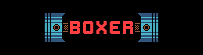
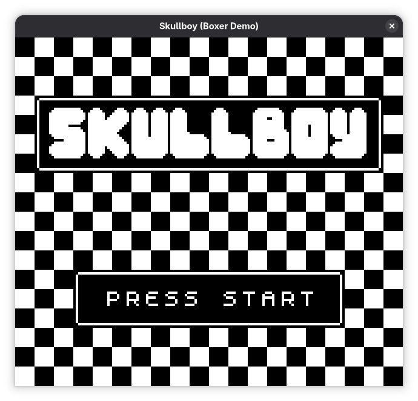
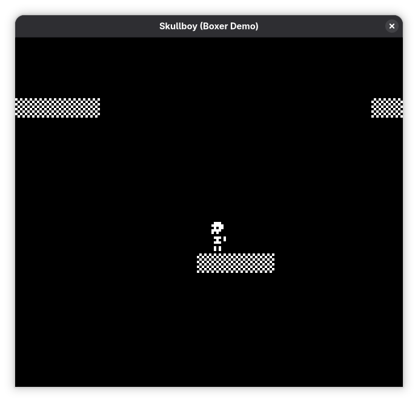

<p align="center">
  
</p>

_The Boxer project draws its name from the boxer engine architecture found in cars, symbolizing efficiency in a compact form. The logo's left and right ends evoke the horizontally opposed pistons of the boxer engine's flat design._

# Boxer

**Boxer** is a lightweight 2D game framework built on top of [SDL3](https://www.libsdl.org/) for rapid development of simple games.

## Why Boxer?

Boxer grew out of three passions: game development, C programming, and reading technical books. Those interests shaped its design and philosophy. The goal is a framework that is **easy to use** without sacrificing **efficiency**.

## Prerequisites

Install the following development dependencies (via your package manager or from source):

- node (optional, for documentation generation).
- GNU Make.
- C compiler.
- SDL3 (>= 3.4.2).

## Features

Boxer is currently focused on 2D games and applications. Out of the box, it provides:

- **Asset management**: load resources from `.zip`, `.7z` and other archive formats.
- **2D rendering**: support for custom shaders and pipelines.
- **Images**: `.bmp` and `.png` support.
- **Audio**: `.wav` and `.ogg` playback.
- **Configuration**: read and write `.ini` files.
- **Input**: keyboard, mouse, and gamepad handling.
- **Math**: vectors, matrices, and transformation utilities.
- **ECS**: an entity-component system for flexible game object management.

## Getting Started

The best way to learn Boxer is to dive into the [documentation](https://nsix.blog/boxer) and read the code of the [demo](https://github.com/n67094/boxer/tree/main/demo).

Here is a simple example of how to initialize the library and create a window:

```c
#include <boxer/bxr.h>

// Define the game configuration
static bxr_game_config_t _config = { 0 };

// Allows boxer to get the game configuration
const bxr_game_config_t *
bxr_game_config(void)
{
  _config.name  = "application_name";
  _config.title = "Window Title";

  _config.width  = 160 * 4;
  _config.height = 144 * 4;

  _config.virtual_width  = 160;
  _config.virtual_height = 144;

  _config.fullscreen = false;
  _config.resizable  = false;

  return &_config;
}

void
bxr_game_setup(void)
{
    // Initialize game state here.
}

void
bxr_game_update(double delta_ms)
{
    // Update the game logic here.
    // The logic is updated at a fixed timestep depending on the refresh rate of the screen it's running on.
}

void
bxr_game_render(double alpha_ms)
{
    // Render the game here.
    // The game is rendered as many times per second as possible.
}

void
bxr_game_teardown(void)
{
    // Clean up game state here.
}
```

## Build and Run Demo

To run the demo, you just have to run the following commands:

```bash
cd demo
make
./demo
```

<p align="center">
  
</p>

## Build and Install Boxer as a Library (Optional)

Here are the steps to build and install `libboxer` on your system.

First, clone the repository with:

```bash
git clone git@github.com:n67094/boxer.git
cd boxer
git submodule update --init --recursive
```

Build the library with:

```bash
make
```

By default, `make install` installs the library to `/usr/lib` and the headers to `/usr/include/boxer` on Linux, and under `/usr/local` on macOS (requires root):

```bash
sudo make install
```

Use `PREFIX` to install elsewhere. On macOS, the install path is recorded in the library at build time, so pass the same `PREFIX` to both commands:

```bash
make PREFIX=$HOME/.local
make install PREFIX=$HOME/.local
```

Uninstall the library with:

```bash
make uninstall
```

Build documentation with:

```bash
make docs
```

# AI Usage Policy

I want this project to remain as human as possible; please check out the [AGENTS.md](AGENTS.md).

# Contributing

Feel free to suggest features, report bugs, or submit pull requests to improve the Boxer library. Your contributions are welcome!

# Support Me

Hi everyone, I'm nsix, an indie game developer and open source contributor trying to make a living from my work.

If you enjoy what I create and want to support me, consider becoming a sponsor on [GitHub Sponsors](https://github.com/sponsors/n67094).
Every bit of support means a lot and is greatly appreciated! Also I have two cats to feed.

You can also check out my blog at [nsix.blog](https://www.nsix.blog).

# License

This project is licensed under the `zlib` License. See the [LICENSE](LICENSE) file for details.
