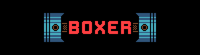
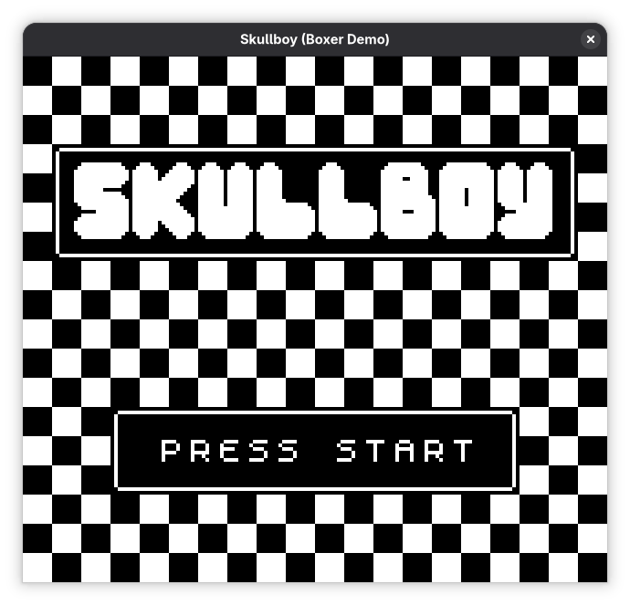
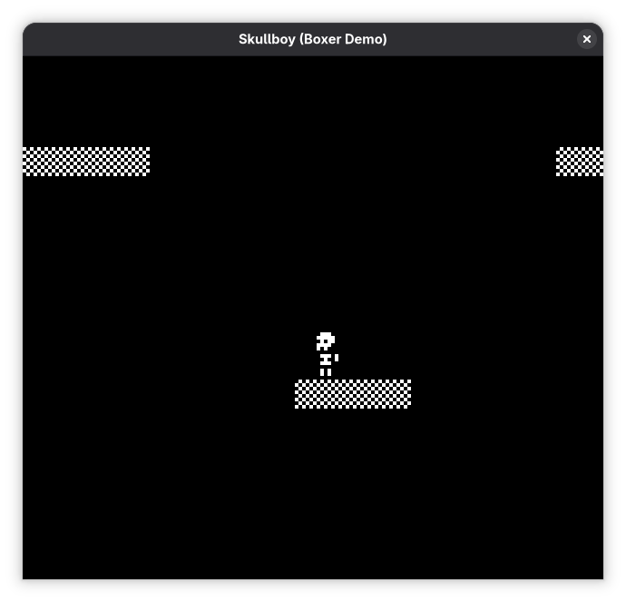

<p align="center">
  
</p>

_The Boxer project draws its name from the boxer engine architecture found in cars, symbolizing efficiency in a compact form. The logo's left and right ends evoke the horizontally opposed pistons of the boxer engine's flat design._

# Boxer

> Build games fast with a lightweight, cross-platform 2D game library written in C.

Features:

- Asset management and resource loading from `.zip`, `.7z`, and other archive formats.
- 2D immediate mode rendering with support for custom shaders and pipelines.
- Image loading and rendering support for `.bmp` and `.png` formats.
- Audio loading and playback support for `.wav` and `.ogg` formats.
- Read/write support for `.ini` files.
- Keyboard, mouse, and gamepad input handling.
- Math utilities for vectors, matrices, and transformations.
- An entity-component system (ECS) for flexible game object management.

Todo:

- Immediate mode UI

## Prerequisites

Install the following development dependencies (via your package manager or from source):

- node (optional, for documentation generation).
- GNU Make.
- C compiler.
- SDL3 (>= 3.4.2).

## Build and Installation

First clone the repository with:

```bash
git clone git@github.com:n67094/boxer.git
cd boxer
git submodule update --init --recursive
```

Build the library with:

```bash
make
```

By default, make install installs the library to /usr/lib and the headers to /usr/include/boxer (requires root). Use PREFIX to install elsewhere:

```bash
make install
# or
make install PREFIX=$HOME/.local
```

Uninstall the library with:

```bash
make uninstall
```

Build documentation with:

```bash
make docs
```

Once `boxer` is installed on your system, in order to run the demo you may need to update the shared library cache with:

```bash
sudo ldconfig
```

Then you can build the demo with:

```bash
cd demo
make
./demo
```

_let's make it roar!_

# Getting Started

To get started with Boxer, you can:

- Check out the [demo](demo) directory for code demonstrating how to use the library's features.
- Generate the documentation with `make docs` to get detailed information on the API and how to integrate it in your projects.

Here is a simple example of how to initialize the library and create a window:

```c
#include <boxer/bxr.h>

// Define the game configuration
static bxr_game_config_t _config = { 0 };

// Allows boxer to get the game configuration
const bxr_game_config_t *
bxr_game_config(void)
{
  _config.name  = "application_name";
  _config.title = "Window Title";

  _config.width  = 160 * 4;
  _config.height = 144 * 4;

  _config.virtual_width  = 160;
  _config.virtual_height = 144;

  _config.fullscreen = false;
  _config.resizable  = false;

  return &_config;
}

void
bxr_game_setup(void)
{
    // Initialize game state here
}

void
bxr_game_update(double delta_ms)
{
    // Update the game logic here.
    // The logic is updated at a fixed timestep depending on the screen refresh rate it's running on
}

void
bxr_game_render(double alpha_ms)
{
    // Render the game here.
    // The game is rendered as many times per second as possible
}

void
bxr_game_teardown(void)
{
    // Clean up game state here
}
```

# Demo

The demo is a simple game that showcases the features of the Boxer library. It includes a title screen, a level with a player character, and basic input handling.

Check out the [demo](demo) directory for the source code to see how the game is implemented using the Boxer library.

<p align="center">
  
  
</p>

# AI Usage Policy

I want this project to remain as human as possible, please check out the [AGENTS.md](AGENTS.md).

# Sponsors

Hi everyone, I'm nsix, an indie game developer and open source contributor trying to make a living from my work.

If you enjoy what I create and want to support me, consider becoming a sponsor on [GitHub Sponsors](https://github.com/sponsors/n67094).
Every bit of support means a lot and is greatly appreciated!

You can also check out my blog at [nsix.blog](https://www.nsix.blog).

# License

This project is licensed under the `zlib` License. See the [LICENSE](LICENSE) file for details.
